# Kaizen

App de rotinas e hábitos para iOS. Você agrupa tarefas em rotinas diárias, semanais ou mensais, marca o que fez e acompanha a sua constância com sequências, estatísticas, prêmios e um resumo da semana.

Trabalho final da disciplina de Desenvolvimento Mobile.
Integrantes: Bernardo Brandão, Marco Antônio Barro Tortelli e Bruno Baldiga.

## Funcionalidades

- **CRUD completo** de rotinas, tarefas e categorias, salvo em SQLite.
- **Tela Hoje** com todas as tarefas do dia, da semana e do mês em uma lista só.
- **Tipos de tarefa:** marcar (checkbox), valor com meta (ex.: 2 L de água) e vezes (ex.: correr 3 vezes na semana).
- **Busca em tempo real** na lista de rotinas.
- **Confirmação** antes de excluir uma rotina.
- **Formulários com validação**: não salva rotina ou tarefa sem nome.
- **Sequência, recorde, estatísticas e mapa de calor** de cada rotina.
- **Pausar** uma rotina e **pular** um dia sem quebrar a sequência.
- **Corrigir dias anteriores** que a pessoa esqueceu de marcar.
- **Galeria de modelos** prontos de rotina.
- **Resumo da semana** e **prêmios** por constância.
- **Lembretes** por horário, com botões “Marcar como feito” e “Adiar 1 hora” na notificação.
- **Widget** na tela de início, com toque para marcar tarefas.
- **Siri e Atalhos**, **app Saúde** (passos, água, exercício, sono, mindfulness), **bloqueio com Face ID** e **backup** em arquivo.

## Telas

Prints tirados do app rodando no iPhone.

<table>
<tr><td align="center" width="25%">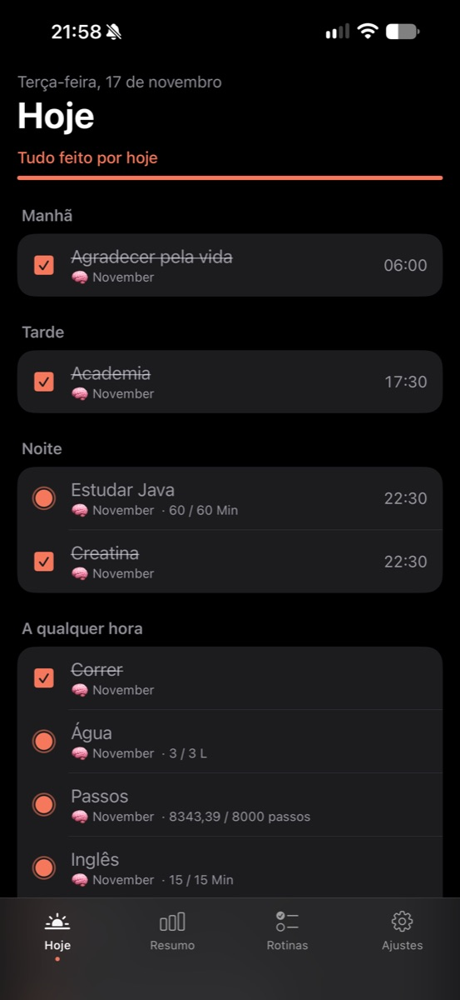<br><sub><b>Hoje</b></sub></td><td align="center" width="25%">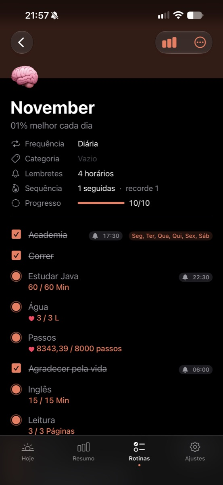<br><sub><b>Detalhe da rotina</b></sub></td><td align="center" width="25%">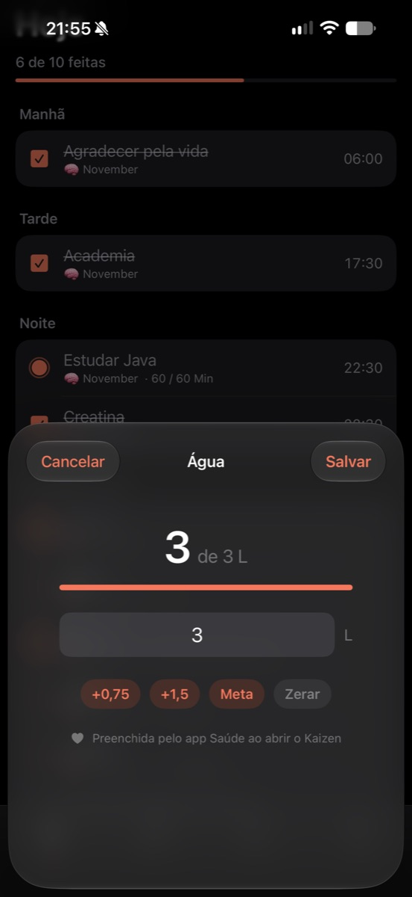<br><sub><b>Anotar valor</b></sub></td><td align="center" width="25%">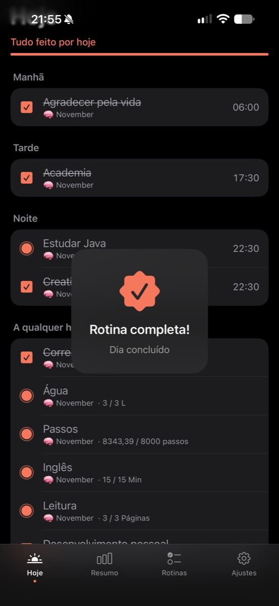<br><sub><b>Rotina completa</b></sub></td></tr>
<tr><td align="center" width="25%">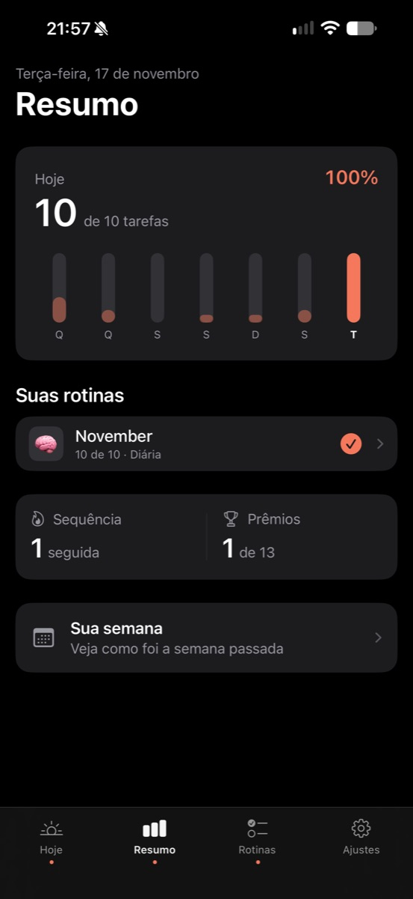<br><sub><b>Resumo</b></sub></td><td align="center" width="25%">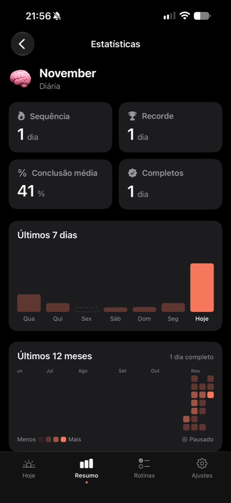<br><sub><b>Estatísticas</b></sub></td><td align="center" width="25%">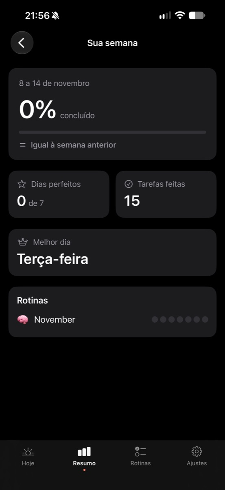<br><sub><b>Sua semana</b></sub></td><td align="center" width="25%">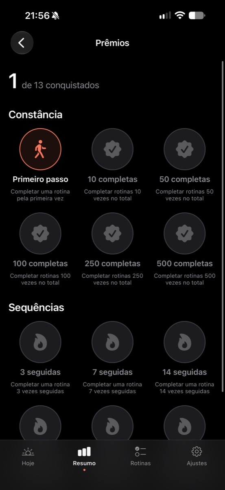<br><sub><b>Prêmios</b></sub></td></tr>
<tr><td align="center" width="25%">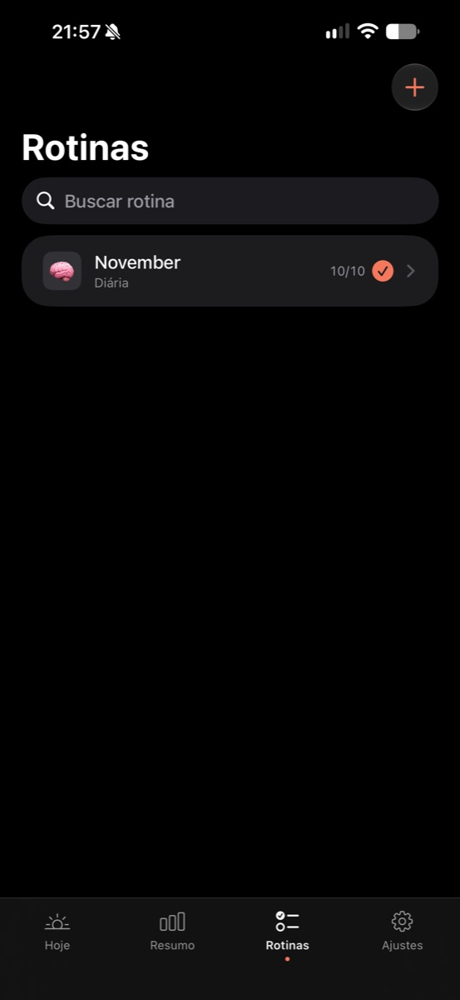<br><sub><b>Rotinas e busca</b></sub></td><td align="center" width="25%">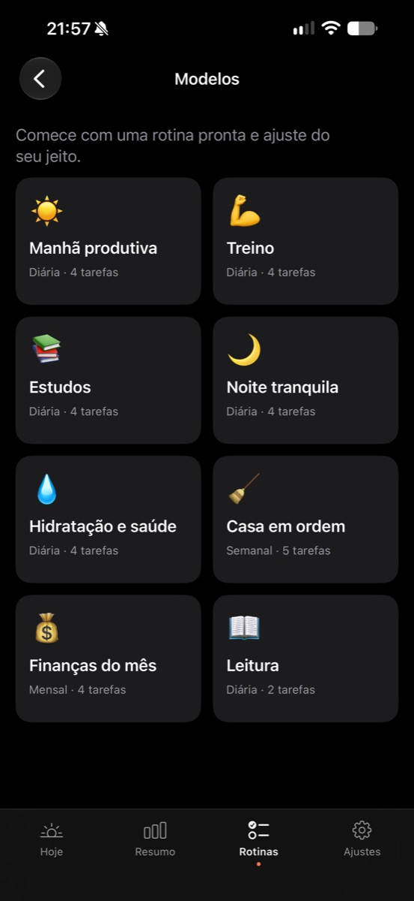<br><sub><b>Modelos prontos</b></sub></td><td align="center" width="25%">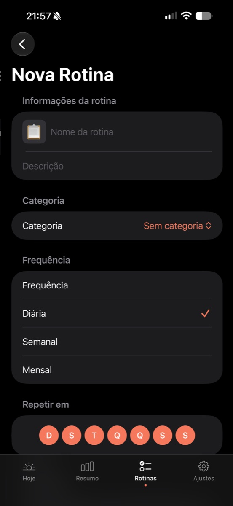<br><sub><b>Nova rotina</b></sub></td><td align="center" width="25%">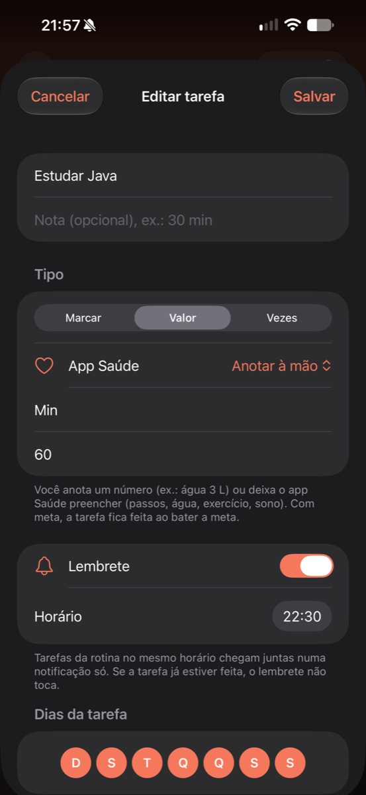<br><sub><b>Editar tarefa</b></sub></td></tr>
<tr><td align="center" width="25%">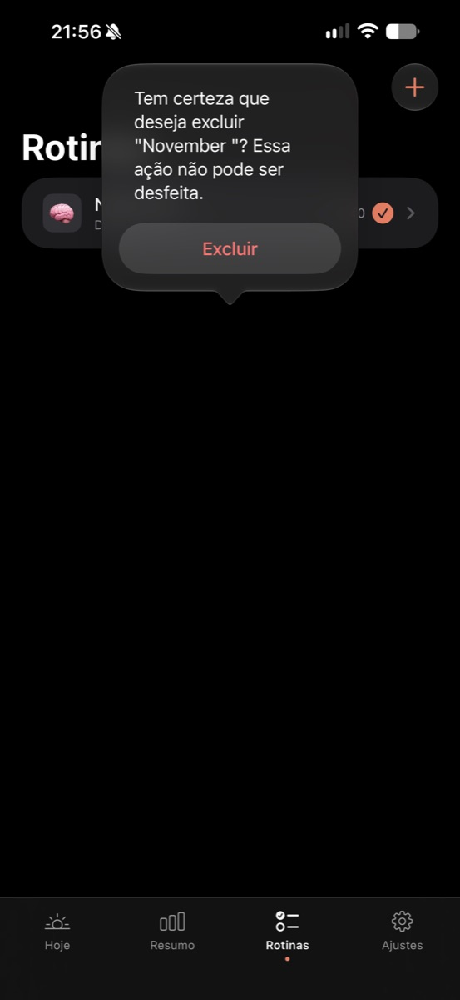<br><sub><b>Confirmação de exclusão</b></sub></td><td align="center" width="25%">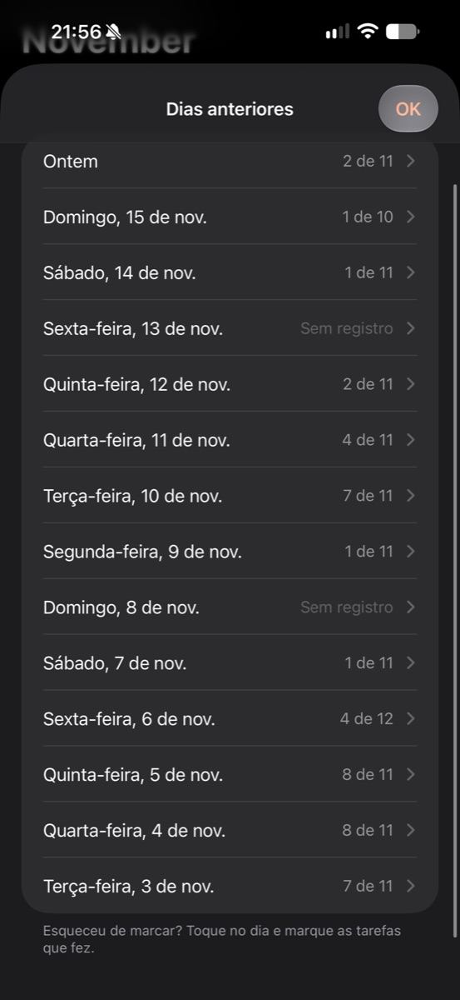<br><sub><b>Dias anteriores</b></sub></td><td align="center" width="25%">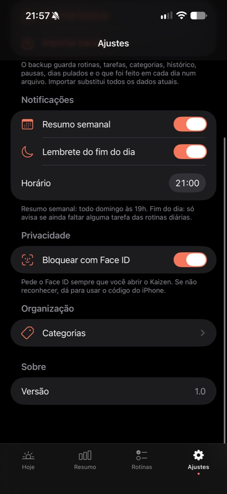<br><sub><b>Ajustes</b></sub></td><td align="center" width="25%">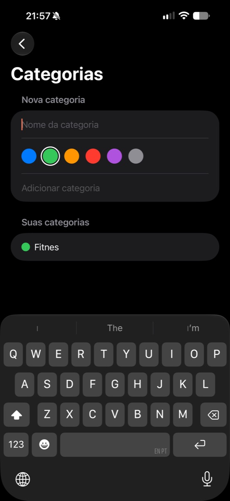<br><sub><b>Categorias</b></sub></td></tr>
</table>

## Tecnologias

- Swift e SwiftUI (app nativo para iOS)
- SQLite com a biblioteca [SQLite.swift](https://github.com/stephencelis/SQLite.swift)
- Arquitetura MVVM + DAO
- WidgetKit, App Intents, UserNotifications, HealthKit, LocalAuthentication
- Swift Testing (88 testes automáticos)

## Como executar

**Requisitos:** um Mac com Xcode 27 ou mais novo. O app roda no simulador do iPhone, sem precisar de aparelho.

1. Clone o repositório:
   ```bash
   git clone https://github.com/Bernardo-Brandao/KaizenApp.git
   ```
2. Abra o arquivo `KaizenApp.xcodeproj` no Xcode.
3. Espere o Xcode baixar a dependência SQLite.swift (Swift Package Manager faz isso sozinho na primeira abertura).
4. No topo da janela, escolha o esquema **KaizenApp** e um simulador de iPhone (ex.: iPhone 18 Pro).
5. Aperte **Cmd+R** para compilar e abrir o app.

Na primeira abertura aparece a tela de boas-vindas. Dá para criar uma rotina do zero ou começar por um modelo pronto.

**Rodar os testes:** com o projeto aberto, aperte **Cmd+U**.

**Rodar num iPhone de verdade:** em *Signing & Capabilities*, escolha o seu time nos alvos **KaizenApp** e **KaizenWidget**. Se não for o time original, troque também o identificador do app e o do App Group (`group.com.bernardobrandao.projeto.KaizenApp`) nos dois alvos e em `Compartilhado/AppGroup.swift`.

## Estrutura do projeto

```
KaizenApp/
├── Compartilhado/        Código usado pelo app e pelo widget
│   ├── Modelos/          Models: Rotina, Tarefa, Categoria, HistoricoDia
│   ├── Dados/            DatabaseManager (SQLite) e os DAOs de cada tabela
│   ├── DataUtil.swift    Datas e períodos (dia, semana, mês)
│   └── NotificationManager.swift
├── KaizenApp/
│   ├── KaizenAppApp.swift   Ponto de entrada: abas, Face ID, links kaizen://
│   ├── ViewModels/          Um ViewModel por tela (MVVM)
│   ├── Views/               Telas em SwiftUI
│   ├── Services/            App Saúde, Face ID, backup, notificações, widget
│   ├── Intents/             Ações da Siri e do app Atalhos
│   └── Models/              Modelos de rotina prontos
├── KaizenWidget/         Widgets da tela de início
└── KaizenAppTests/       Testes automáticos
```

**Fluxo das camadas:** a View chama o ViewModel, o ViewModel chama o DAO, o DAO lê e grava no SQLite. Quando os dados mudam, o ViewModel publica a mudança (`@Published`) e a tela se redesenha sozinha.

**Banco de dados (8 tabelas):** `rotinas`, `tarefas`, `categorias`, `conclusoes`, `registros_tarefa`, `historico_rotina`, `pausas` e `pulos`, com campos de texto, número e booleano.

Mais detalhes sobre como o app funciona estão em [COMO-FUNCIONA.md](COMO-FUNCIONA.md).
